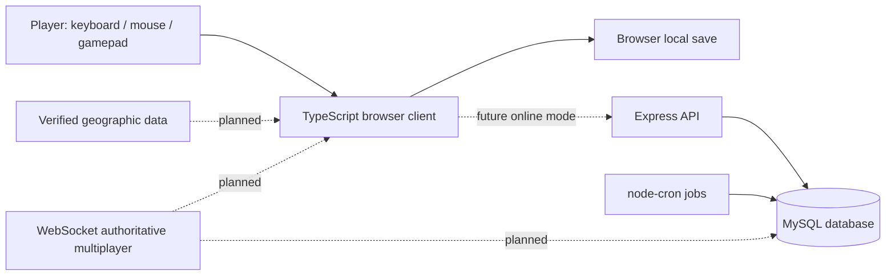
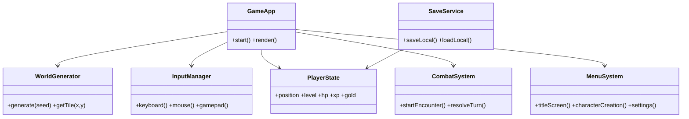
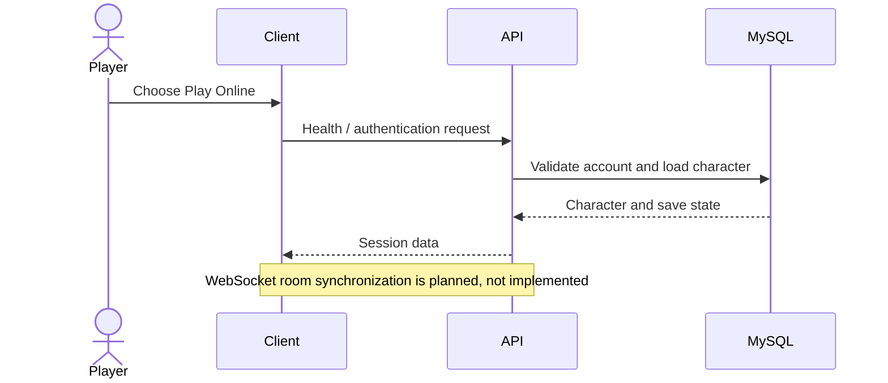
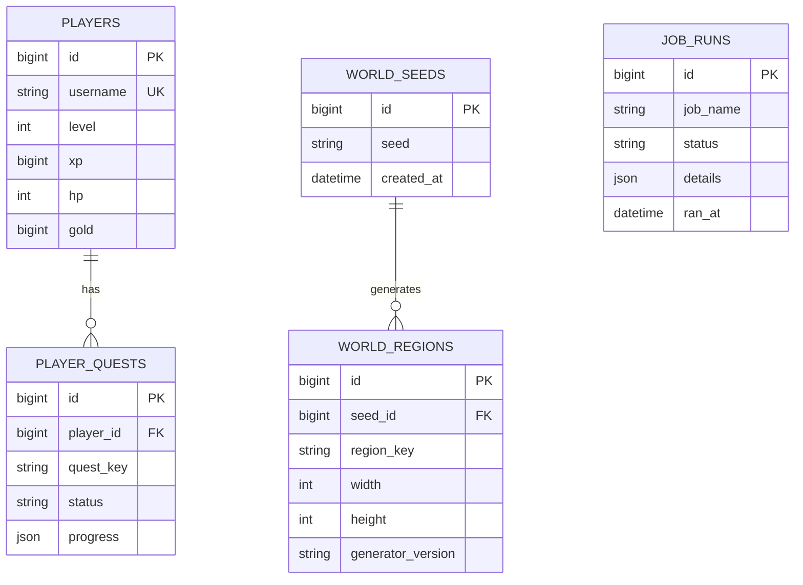

# Architecture and UML

## System context

## Client module diagram

This is a target logical design; the current client is a compact prototype and does not yet implement every class as a separate module.

## Server sequence: future online join

## ER model

## Deployment notes
- Keep MySQL credentials in environment variables; never commit `.env`.
- Use TLS, authentication, authorization, input validation, rate limits, and server-side state validation before exposing online services.
- In multi-instance production, use a distributed scheduler lock so cron jobs do not run multiple times.
- Version world-generation algorithms and content schemas to preserve seeded-world compatibility.